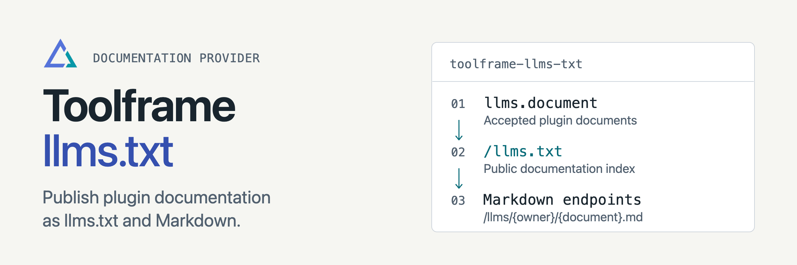

<p align="center">
<picture>
  <source media="(prefers-color-scheme: dark)" srcset="docs/assets/readme-banner-dark.png">
  <source media="(prefers-color-scheme: light)" srcset="docs/assets/readme-banner-light.png">
  
</picture>
</p>

# Toolframe llms.txt

[](https://github.com/toolframe/toolframe-llms-txt/actions/workflows/ci.yml?query=branch%3Amain)

Publish plugin documentation at `/llms.txt` and linked Markdown URLs.
The provider serves the accepted `llms.document` resources supplied by business plugins.

## Quick start

In a running [Toolframe application](https://github.com/toolframe/toolframe-core#readme):

```sh
toolframe --home APP plugin add pypi:toolframe-llms-txt==0.3.1 --enable
```

Use Python 3.14+ and a compatible SDK. Add a plugin that declares an llms document,
then open `/llms.txt` on your application's URL. The Entry Register recipe already
includes this provider and an example document.

**Publication:** documents are public. Publish only content intended for anonymous
readers. Each committed catalog replaces the index and documents together;
withdrawn resources disappear. The provider serves supplied text and does not
scan package paths or the filesystem during requests.

## Guides

| I want to… | Start here |
| --- | --- |
| Configure the index and publication | [Document publication](docs/publication.md) |
| Declare plugin resources | [SDK contracts](https://github.com/toolframe/toolframe-sdk#readme) |
| Contribute or run checks | [Contributing](CONTRIBUTING.md) · [Verification](docs/ci.md) |
| Publish a package | [Releasing](docs/releasing.md) |

[Releases](https://github.com/toolframe/toolframe-llms-txt/releases)

## License

[Apache 2.0](LICENSE), with [NOTICE](NOTICE).
